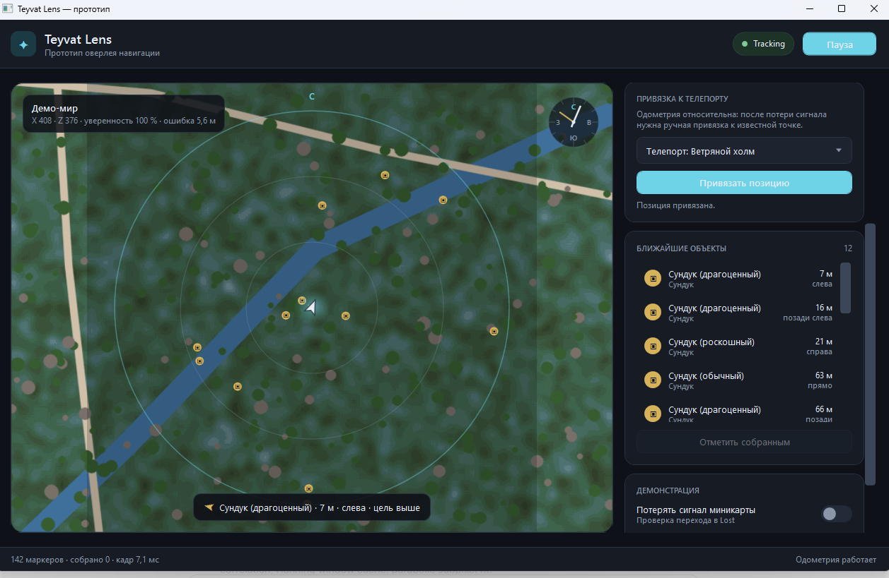

# Teyvat Lens — MVP-прототип

Оверлей-навигатор для Genshin Impact: показывает ближайшие сундуки и ресурсы относительно
положения игрока. Прототип реализует относительную локализацию по миникарте (одометрия),
локальную базу маркеров в SQLite и рабочее окно с картой, компасом и подсказкой.

> **Статус:** учебный MVP. Абсолютная релокализация по атласу, прозрачный оверлей поверх игры
> и захват через Windows Graphics Capture остаются за рамками этой версии.
> Подробности — в [docs/PROTOTYPE_REPORT.md](docs/PROTOTYPE_REPORT.md).



## Что умеет

- **Демо-режим без игры:** синтетический мир 900×900 м, атлас, маршрут и 142 маркера.
- **Режим захвата экрана:** квадратная область миникарты, масштаб px/м и ручная привязка к телепорту.
- **Одометрия по миникарте:** фазовая корреляция на нативном разрешении, окно Ханна и
  параболическое уточнение пика.
- **Честные состояния** `Tracking` / `Degraded` / `Lost`: при потере сигнала позиция не показывается.
- **Локальная база SQLite:** типы маркеров, маркеры, R\*Tree-индекс, отметки «собрано», настройки.
- **Навигация:** ближайший объект, расстояние, направление (прямо / справа / слева / позади),
  подсказка «выше/ниже», фильтр по типу и радиусу поиска.
- **Сохранение прогресса** между запусками и сброс прогресса.

## Стек

C# 12 / .NET 8, WPF, OpenCvSharp4 4.13, Microsoft.Data.Sqlite, xUnit.

## Требования

- Windows 10/11 x64.
- .NET SDK 8.0 (проверено на 8.0.428).
- Для режима захвата — игра в оконном режиме без рамки (не эксклюзивный fullscreen).

## Установка и запуск

```powershell
git clone <repo-url>
cd genshin-overlay
dotnet build TeyvatLens.sln
dotnet run --project src/TeyvatLens.App/TeyvatLens.App.csproj
```

При первом запуске автоматически создаются:

- `data/teyvat_lens.db` — база с 142 демонстрационными маркерами;
- `data/demo_atlas.png` — атлас демо-мира 1800×1800 px.

Оба файла генерируются заново и в репозиторий не входят.

Готовый исполняемый файл:
`src/TeyvatLens.App/bin/Debug/net8.0-windows/TeyvatLens.App.exe`.

## Как пользоваться

### Демо-мир

1. Оставьте режим «Демо-мир» и нажмите **Старт**.
2. Игрок движется по маршруту; карта, компас, список объектов и подсказка обновляются 15 раз в секунду.
3. Переключатель **«Потерять сигнал миникарты»** проверяет переход в `Lost` и требование повторной привязки.
4. **«Привязать позицию»** телепортирует демо-игрока к выбранной точке маршрута.

### Захват экрана

1. Переключитесь на **«Захват экрана»** и нажмите **«Настроить область захвата»**.
2. Укажите квадрат вокруг миникарты (X, Y, размер в пикселях экрана) и масштаб px/м.
3. Нажмите **Старт**, затем **«Привязать позицию»** к известному телепорту — дальше работает одометрия.

## Тесты

```powershell
dotnet test tests/TeyvatLens.Tests/TeyvatLens.Tests.csproj
```

28 тестов: геометрия, навигация, локализация, база данных и интеграция с демо-миром.
Фактические результаты и замеры — в [docs/PROTOTYPE_REPORT.md](docs/PROTOTYPE_REPORT.md).

## Структура решения

| Путь | Назначение |
|---|---|
| `src/TeyvatLens.Core/` | домен, компьютерное зрение, локализация, SQLite, прикладной сценарий (без WPF) |
| `src/TeyvatLens.App/` | WPF-интерфейс: карта, компас, список объектов, калибровка |
| `tests/TeyvatLens.Tests/` | xUnit-тесты |
| `tools/Probe/` | диагностический прогон конвейера с замерами (вне решения) |
| `data/` | генерируемые база и атлас (не коммитятся) |
| `docs/` | архитектура, план, отчёт о прототипе |
| `PROJECT.md` | полное описание проекта и техническая архитектура |

## Ограничения MVP

- Только относительная локализация: дрейф ≈ 4 % пройденного пути, нужна повторная привязка.
- Миникарта считается north-up; вращение вместе с камерой не поддерживается.
- Захват экрана — GDI/BitBlt, а не Windows Graphics Capture; эксклюзивный fullscreen не поддерживается.
- Окно приложения обычное, а не прозрачный click-through оверлей.
- Нет абсолютной релокализации по атласу, фильтра Калмана, горячих клавиш и трея.
- Режим захвата не проверен на реальной игре: в среде разработки её нет.

## Дисклеймер

Проект не читает память игры, не внедряется в процесс и не эмулирует ввод. Взаимодействие
ограничено захватом экрана. Правила HoYoverse запрещают сторонний софт, взаимодействующий
с клиентом, поэтому используйте на свой риск.
