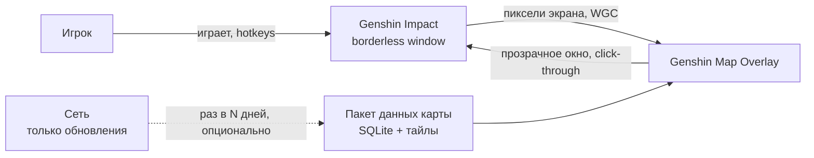
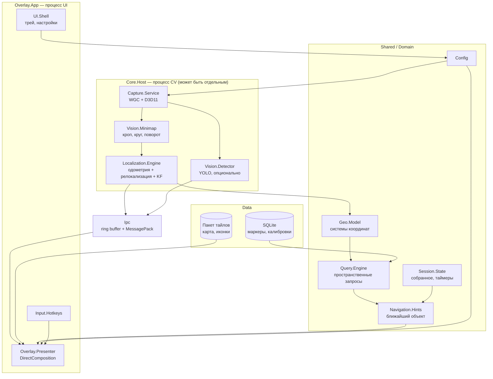
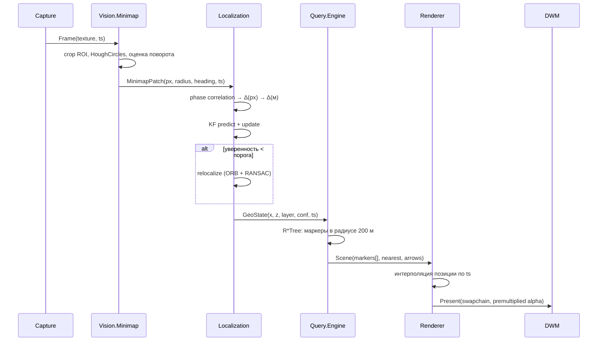
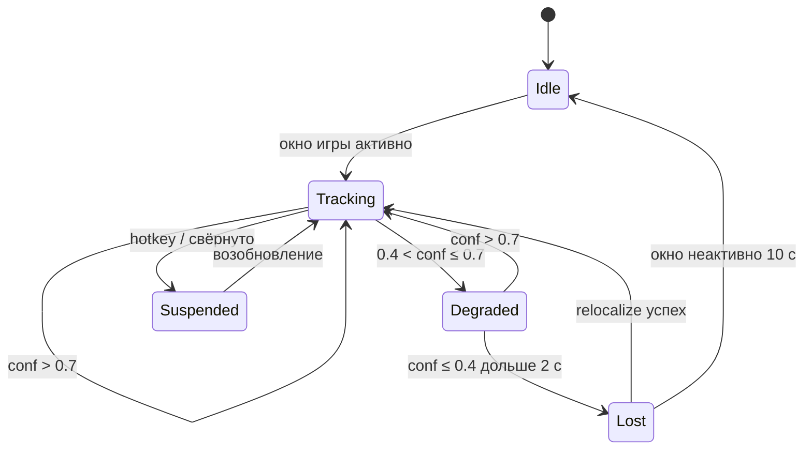
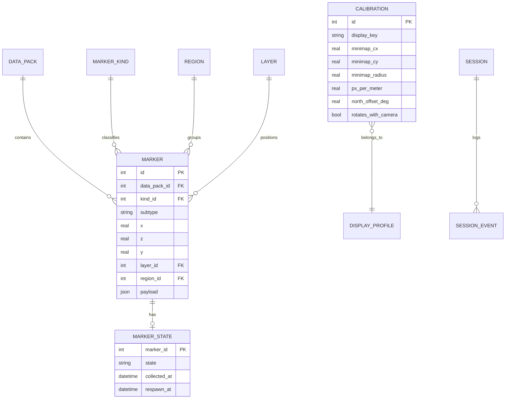

# Genshin Map Overlay — предварительная техническая архитектура

**Версия:** 0.1 (draft)
**Дата:** 2026-11-10
**Статус:** на согласование
**Связанные документы:** `PLAN.md` (план реализации и MVP)

---

## 0. Резюме

Проект — **read-only** оверлей: читает изображение экрана, определяет положение игрока по внутреигровой
миникарте, сопоставляет его с локальной базой маркеров (сундуки, ресурсы, точки интереса) и рисует
поверх игры прозрачное окно со стрелкой, дистанцией и собственной миникартой.

Ключевое архитектурное решение: **три независимых контура с разной частотой**

| Контур | Частота | Где считается | Критичность |
|---|---|---|---|
| Захват кадра | 30–60 Гц | GPU (WGC → D3D11 текстура) | высокая |
| Зрение + локализация | 10–15 Гц | CPU/GPU, отдельный процесс | средняя |
| Рендер оверлея | 60 Гц | GPU (DirectComposition) | высокая |

Позиция игрока обновляется редко, рендер — часто. Между ними **интерполяция + Калман**, поэтому
картинка остаётся плавной при 10 Гц распознавания.

Принципы:
- **Offline-first.** Никаких сетевых вызовов в рантайме, база данных поставляется пакетом.
- **Read-only.** Никакой инъекции, хуков, чтения памяти, эмуляции ввода.
- **Graceful degradation.** При потере уверенности оверлей не врёт, а честно показывает «позиция неизвестна».
- **Сменные реализации.** CV-часть можно заменить с C# на Python-сервис без переписывания UI.

---

## 1. Границы проекта, допущения, ограничения

### 1.1 В scope
- Windows 10 1903+ / Windows 11, x64.
- Захват окна игры в режиме **borderless windowed**.
- Локализация по миникарте, база маркеров, отрисовка оверлея, трекинг собранного.
- Один монитор с игрой (мультимонитор — второй экран как «компаньон»).

### 1.2 Вне scope (v1)
- Автоматизация действий, автопути, кликеры — **сознательно нет**.
- Чтение памяти игры, инъекция DLL, хукинг графического API.
- Мобильные платформы, консоли.
- Мультиплеерные/сетевые функции, аккаунты.

### 1.3 Допущения
- Миникарта имеет **фиксированный** масштаб (пикс/метр) и фиксированное положение в HUD, зависящее
  только от разрешения и HUD-scale.
- Миникарта либо «north-up», либо вращается с камерой — **уточняется на этапе 0** (см. §12, вопрос Q1).
- Мир игры представим плоскостью XZ + слоями (поверхность / подземелья / домены), Y используется
  только для подсказки «выше/ниже».

### 1.4 Ограничения
- Эксклюзивный fullscreen — не поддерживается (технически невозможно рисовать поверх).
- Смена разрешения/HUD-scale инвалидирует калибровку → требуется повторная.
- Античит и ToS: см. §11.3.

---

## 2. Архитектурная схема

### 2.1 Контекст (C4-L1)



### 2.2 Компоненты (C4-L2)



### 2.3 Потоки и процессы

```
┌────────────────────────────── Core.Host (процесс 1) ─────────────────────────────┐
│                                                                                  │
│  CaptureThread ──frame──▶ FrameRing[2] ──▶ VisionThread ──▶ FusionThread         │
│  (60 Гц, GPU)             (GPU текст.)      (15 Гц, CV)      (15 Гц, KF)          │
│                                                   │                │              │
│                                                   ▼                ▼              │
│                                            DetectorThread    SharedState          │
│                                            (5 Гц, ONNX)      (seqlock)           │
└───────────────────────────────────────────────────┬──────────────────────────────┘
                                                    │ SharedMemory + MessagePack
┌────────────────────────────── Overlay.App (процесс 2) ───────────────────────────┐
│                                                    ▼                             │
│  RenderThread (60 Гц):  SharedState ─▶ Interpolator ─▶ SceneBuilder ─▶ Skia/D2D  │
│  UIThread:              трей, настройки, hotkeys, DPI-события                    │
└──────────────────────────────────────────────────────────────────────────────────┘
```

Разделение на два процесса даёт:
- падение CV не убивает оверлей (и наоборот);
- можно подменить `Core.Host` на Python-прототип;
- проще профилировать и ограничивать приоритеты потоков.

### 2.4 Последовательность: «кадр → иконка сундука на экране»



---

## 3. Перечень модулей

| # | Модуль | Процесс | Ответственность | Вход | Выход |
|---|---|---|---|---|---|
| M1 | `Capture.Service` | Core | Захват окна игры, GPU-текстура, метка времени, детект «окно свёрнуто/сменилось разрешение» | HWND, настройки | `FrameLease` |
| M2 | `Vision.Minimap` | Core | Поиск круга миникарты, кроп, нормализация, оценка поворота/масштаба | `FrameLease` | `MinimapPatch` |
| M3 | `Localization.Engine` | Core | Одометрия, релокализация, Калман, confidence, детект телепорта/загрузки | `MinimapPatch` | `GeoState` |
| M4 | `Vision.Detector` | Core | (опц.) YOLO по полному кадру: сундуки, NPC, интерактивные объекты | `FrameLease` | `Detection[]` |
| M5 | `Geo.Model` | Shared | Системы координат, аффинные преобразования, работа со слоями | точки | точки |
| M6 | `Query.Engine` | Shared | Пространственные запросы к БД, фильтры по типу/радиусу/слою | `GeoState`, фильтры | `Marker[]` |
| M7 | `Navigation.Hints` | Shared | Скоринг «что показать», азимут, дистанция, «выше/ниже» | `GeoState`, `Marker[]` | `HintSet` |
| M8 | `Session.State` | Shared | Что уже собрано, таймеры респавна, история сессии | id маркеров | состояние |
| M9 | `Overlay.Presenter` | UI | Прозрачное окно, композитинг, click-through, интерполяция | `Scene` | пиксели |
| M10 | `UI.Shell` | UI | Трей, настройки, калибровочный визард, диагностика | — | конфиг |
| M11 | `Input.Hotkeys` | UI | Глобальные хоткеи (toggle, скрыть UI, калибровка) | клавиши | события |
| M12 | `Data.Store` | Shared | SQLite: миграции, репозитории, импорт пакетов, транзакции | SQL | домен |
| M13 | `Data.Tiles` | Shared | Провайдер тайлов карты и иконок, LRU-кэш, декод | (z, x, y) | текстура |
| M14 | `Platform.Win32` | Shared | DPI, topmost, `WDA_EXCLUDEFROMCAPTURE`, работа с окнами | HWND | — |
| M15 | `Ipc` | Shared | Shared memory ring, контракты сообщений, версионирование схем | `GeoState` | байты |
| M16 | `Config` | Shared | Настройки, профили калибровки, миграции | JSON | типизированный объект |
| M17 | `Telemetry` | Shared | Локальные логи, счётчики fps/latency/дрейфа, экспорт отчёта | события | файлы |

### 3.1 Контракты ключевых модулей

```csharp
// M2 → M3
public readonly record struct MinimapPatch(
    ReadOnlyMemory<byte> Gray,   // нормализованный кроп, 256×256
    Point2 CenterPx,             // центр круга в координатах кадра
    float RadiusPx,
    float HeadingDeg,            // направление камеры, 0 = север
    bool HeadingValid,
    long TimestampMs,
    float Quality);              // 0..1, насколько чистый кроп

// M3 → M6/M7/M9
public readonly record struct GeoState(
    double X, double Z, double? Y,
    int LayerId,
    float HeadingDeg,
    float Confidence,            // 0..1
    LocalizationSource Source,   // Odometry | Relocalized | Manual
    long TimestampMs,
    string? RegionCode);

// M6 → M7
public sealed record Marker(
    long Id, MarkerKind Kind, string? Subtype,
    double X, double Z, double? Y, int LayerId,
    double DistanceM, double BearingDeg,
    bool Collected, DateTimeOffset? RespawnAt);
```

---

## 4. Взаимодействие модулей

### 4.1 Стиль взаимодействия

| Связь | Механизм | Обоснование |
|---|---|---|
| Внутри процесса | Прямые вызовы + `Channel<T>` | дёшево, типизировано |
| Capture → Vision | **Shared GPU текстура** (D3D11) + `seqlock` | zero-copy, 60 Гц |
| Core → UI | **Shared memory + MessagePack**, 200 Гц макс | изоляция процессов |
| Домен → БД | Репозитории, одна транзакция на пакет | консистентность |
| UI → Core | named pipe, команды (`recalibrate`, `pause`) | редкие вызовы |
| Всё → Telemetry | Асинхронная очередь, drop-oldest | не блокирует |

**Правило:** никакой модуль не читает состояние другого напрямую, кроме `SharedState`,
который публикуется атомарно целиком (immutable snapshot + sequence number). Это убирает
блокировки в горячем пути.

### 4.2 Бюджеты (целевые)

| Участок | Бюджет | Примечание |
|---|---|---|
| WGC acquire → готовый кадр | ≤ 2 кадра | задержка захвата |
| Кроп + Hough + поворот | ≤ 2 мс | 640×640 |
| Phase correlation | ≤ 1 мс | FFT 512×512 |
| KF update | ≤ 0.1 мс | 4 состояния |
| Релокализация | ≤ 25 мс | раз в 1–3 с, в фоне |
| Query + hints | ≤ 1 мс | R*Tree |
| Рендер кадра | ≤ 3 мс CPU / ≤ 1 мс GPU | Skia + DComp |
| **Суммарная задержка** | **≤ 120 мс** | от реального мира до пикселя |

### 4.3 Режимы и деградация



| Режим | CV | Рендер | Что видит игрок |
|---|---|---|---|
| Idle | 0 Гц | пауза | ничего |
| Tracking | 15 Гц | 60 Гц | полный оверлей |
| Degraded | 15 Гц + форс релокализации | 60 Гц | оверлей + «уточняю позицию» |
| Lost | 5 Гц, только релокализация | 60 Гц | только компас/скрыто |
| Suspended | 0 Гц | пауза | ничего |

---

## 5. Данные

### 5.1 Классификация

| Категория | Изменяемость | Где живёт | Объём (оценка) |
|---|---|---|---|
| Маркеры (сундуки, ресурсы, POI) | статична, обновляется пакетами | SQLite (read-mostly) | 100k–300k строк, ~40 МБ |
| Тайлы карты | статична | файловый пакет + LRU-кэш | 1–3 ГБ (z0–z6) |
| Иконки | статична | PNG/SVG в пакете | < 5 МБ |
| Калибровки | на пользователя/разрешение | SQLite | килобайты |
| Прогресс (собрано) | часто | SQLite | до 300k строк |
| Настройки | редко | JSON | килобайты |
| Телеметрия | постоянно | JSONL с ротацией | ≤ 100 МБ |
| Модели (ONNX) | по версии | файлы | 6–20 МБ |

### 5.2 ER-модель



### 5.3 DDL (сокращённо)

```sql
PRAGMA journal_mode = WAL;
PRAGMA synchronous  = NORMAL;

CREATE TABLE data_pack (
    id          INTEGER PRIMARY KEY,
    code        TEXT NOT NULL UNIQUE,   -- 'map-2026.11'
    version     TEXT NOT NULL,
    game_version TEXT,
    imported_at TEXT NOT NULL,
    checksum    TEXT NOT NULL
);

CREATE TABLE marker_kind (
    id      INTEGER PRIMARY KEY,
    code    TEXT NOT NULL UNIQUE,       -- 'chest', 'ore', 'flower', 'waypoint'
    name_ru TEXT NOT NULL,
    icon    TEXT,
    color   TEXT
);

CREATE TABLE region (
    id     INTEGER PRIMARY KEY,
    code   TEXT NOT NULL UNIQUE,
    name_ru TEXT NOT NULL,
    min_x REAL, max_x REAL, min_z REAL, max_z REAL
);

CREATE TABLE layer (
    id     INTEGER PRIMARY KEY,
    code   TEXT NOT NULL UNIQUE,        -- 'surface', 'chasm_underground', 'enkanomiya'
    name_ru TEXT NOT NULL
);

CREATE TABLE marker (
    id           INTEGER PRIMARY KEY,
    data_pack_id INTEGER NOT NULL REFERENCES data_pack(id) ON DELETE CASCADE,
    kind_id      INTEGER NOT NULL REFERENCES marker_kind(id),
    subtype      TEXT,
    x            REAL NOT NULL,
    z            REAL NOT NULL,
    y            REAL,
    layer_id     INTEGER NOT NULL DEFAULT 0 REFERENCES layer(id),
    region_id    INTEGER REFERENCES region(id),
    payload      TEXT                   -- JSON: редкость, группа спавна, источник
);

CREATE INDEX idx_marker_kind  ON marker(kind_id);
CREATE INDEX idx_marker_layer ON marker(layer_id);

-- Пространственный индекс
CREATE VIRTUAL TABLE marker_rtree USING rtree(
    id, min_x, max_x, min_z, max_z
);

CREATE TABLE marker_state (
    marker_id    INTEGER PRIMARY KEY REFERENCES marker(id) ON DELETE CASCADE,
    state        TEXT NOT NULL,         -- 'unknown'|'collected'|'ignored'
    collected_at TEXT,
    respawn_at   TEXT
);

CREATE TABLE display_profile (
    id           INTEGER PRIMARY KEY,
    display_key  TEXT NOT NULL UNIQUE,  -- '2560x1440@150%'
    created_at   TEXT NOT NULL
);

CREATE TABLE calibration (
    id                  INTEGER PRIMARY KEY,
    display_profile_id  INTEGER NOT NULL REFERENCES display_profile(id),
    minimap_cx          REAL NOT NULL,
    minimap_cy          REAL NOT NULL,
    minimap_radius      REAL NOT NULL,
    px_per_meter        REAL NOT NULL,
    north_offset_deg    REAL NOT NULL DEFAULT 0,
    rotates_with_camera INTEGER NOT NULL,
    screen_w            INTEGER NOT NULL,
    screen_h            INTEGER NOT NULL,
    hud_scale           REAL NOT NULL,
    verified_at         TEXT
);

CREATE TABLE setting (
    key   TEXT PRIMARY KEY,
    value TEXT NOT NULL
);
```

Запрос «маркеры в радиусе» — через rtree + JOIN:

```sql
SELECT m.id, m.kind_id, m.x, m.z, m.y, m.layer_id,
       ((m.x - :x)*(m.x - :x) + (m.z - :z)*(m.z - :z)) AS d2
FROM marker_rtree r
JOIN marker m ON m.id = r.id
WHERE r.max_x >= :x - :r AND r.min_x <= :x + :r
  AND r.max_z >= :z - :r AND r.min_z <= :z + :r
  AND m.layer_id = :layer
  AND m.kind_id IN (SELECT value FROM json_each(:kinds))
ORDER BY d2
LIMIT 50;
```

### 5.4 Пакет данных (файлы)

```
packs/map-2026.11/
├── manifest.json        # версия, checksum, game_version, диапазон тайлов
├── markers.sqlite       # маркеры (импортируется в рабочую БД)
├── tiles/
│   ├── z0/…z6/          # WebP-тайлы 256×256
│   └── overlay.png      # слой подписей регионов
└── icons/               # SVG/PNG иконки типов
```

### 5.5 Системы координат

```
CS0  Screen px        (разрешение × DPI)          — точка клика, ROI
 │  affine: crop + scale
 ▼
CS1  Minimap px       (центр = игрок, масштаб px/m)
 │  affine: rotate(-heading) + scale(1/px_per_meter)
 ▼
CS2  World meters     (XZ-плоскость, Y вверх, layer_id)
 │  affine: tile transform (per zoom)
 ▼
CS3  Atlas px         (тайлы z/x/y, источник: комьюнити-дамп)
```

Все преобразования — через `Geo.Model`, единая точка правды. Никаких «магических» констант
в модулях рендера.

### 5.6 Калибровка

Хранится **на профиль дисплея** (`display_key = WxH@DPI`), потому что HUD-scale и разрешение
меняют и радиус, и позицию миникарты.

Процесс (мастер в `UI.Shell`):
1. Автопоиск круга: `HoughCircles` на 20 кадрах, медиана центра/радиуса.
2. Масштаб: два известных ориентира (статуя + телепорт), игрок идёт между ними, замер расстояния в px.
3. Поворот: маркер «N» на миникарте либо форма стрелки игрока.
4. Валидация: 30 с езды, сравнение с релокализацией; при ошибке > 5% — перекалибровка.

---

## 6. Технологии и библиотеки

### 6.1 Основной стек

| Слой | Выбор | Версия | Почему |
|---|---|---|---|
| Runtime | **.NET 8** (LTS) | 8.0 | производительность, P/Invoke, единый язык |
| Язык | **C# 12** | — | быстрая разработка, хорошая экосистема CV |
| Захват | `Windows.Graphics.Capture` через CsWinRT | Win SDK 10.0.22621 | низкий оверхед, GPU-текстура |
| GPU-интероп | `Vortice.Windows` (D3D11/DXGI/DComp) | 3.x | без обёрток-«чёрных ящиков» |
| CV | **OpenCvSharp4** + `OpenCvSharp4.runtime.win` | 4.10 | Hough, phase correlation, ORB, ECC |
| Инференс | `Microsoft.ML.OnnxRuntime` (CUDA/DirectML) | 1.20 | YOLO без Python |
| Рендер | **SkiaSharp** (2D) + DirectComposition | 3.x | скорость, качество текста/иконок |
| БД | **SQLite** через `Microsoft.Data.Sqlite` | 8.x | встроенная, rtree, WAL |
| IPC | `MemoryMappedFile` + **MessagePack-CSharp** | 2.x | ~0 аллокаций, версионируемые контракты |
| Логи | `Serilog` + JSONL | 4.x | структурные логи, ротация |
| Тесты | xUnit + BenchmarkDotNet | — | перф-регрессии обязательны |

### 6.2 Альтернативы (и когда их брать)

| Альтернатива | Когда | Минусы |
|---|---|---|
| Python (`dxcam`, `OpenCV`, `PySide6`) | быстрый прототип CV | GIL, упаковка, FPS-рендер |
| C++20 + Win32 + D2D | максимальный контроль | ×3 времени разработки |
| Rust + `windows` + `wgpu`/`egui` | перф + безопасность | меньше готовых CV-биндингов |
| WPF `AllowsTransparency` | MVP-оверлей за день | layered window, потолок ~30–40 FPS |
| Electron/Tauri | UI настроек | тяжёлый webview в оверлее — нет |
| `mss`/BitBlt | никогда | чёрный экран на GPU-окне |

### 6.3 Инструменты разработки

- **Разметка данных:** CVAT / Roboflow (детекция сундуков).
- **Модели:** Ultralytics YOLOv8n/v11n → ONNX (FP16).
- **Профилирование:** `dotnet-trace`, PIX, NVIDIA Nsight, Superluminal.
- **CI:** сборка + `BenchmarkDotNet` + регрессия точности локализации на записанных сессиях.
- **Запись сессий:** датасет кадров + ground truth позиции (ручная разметка) для офлайн-тестов.

---

## 7. Три наиболее сложные технические задачи

### Задача A. Локализация: «где я» по миникарте

**Почему сложно.** Прямого источника координат нет. Миникарта — маленькое (≈180 px) вращающееся
изображение с наложенным HUD, иконками и виньеткой. Ошибка в 1° поворота на краю круга — это
метры по миру. Нужны одновременно точность, устойчивость к дрейфу и работа в реальном времени.

**Решение — трёхконтурная схема:**

1. **Кроп и нормализация (15 Гц, ≤ 2 мс)**
   - ROI из калибровки → валидация `HoughCircles` (устойчивость к смене HUD).
   - Кроп → серая шкала → CLAHE → маска HUD-элементов (щит/баффы/квест-маркеры вырезаются
     по известным координатам).
   - Оценка поворота: `log-polar` преобразование + phase correlation (**Fourier–Mellin**) —
     даёт поворот и масштаб одним FFT-проходом, без перебора углов.
2. **Одометрия (15 Гц, ≤ 1 мс)**
   - Phase correlation между соседними нормализованными кропами → сдвиг в px.
   - Проверка: `peak_ratio > 4` иначе кадр отбрасывается (движение камеры, катсцена).
   - `Δметры = Δpx / px_per_meter`, поворот в мировые оси через `heading`.
   - Накапливается в Калмане как **управляющий вход**, а не измерение.
3. **Релокализация (1 раз в 1–3 с, ≤ 25 мс, в отдельном потоке)**
   - ORB/AKAZE дескрипторы кропа (500–800 точек) → FLANN-матчинг по атласу.
   - Кандидаты ограничены: сначала круг ±50 м от текущей оценки, при неудаче — глобально.
   - `RANSAC` + аффинная модель → позиция + поворот + число инлайеров как метрика качества.
   - Fallback: NCC-template matching по пирамиде атласа (медленнее, но работает на «бедном» террейне).
4. **Слияние (Калман + HMM)**
   - Состояние `[x, z, vx, vz]`, CV-модель, `Q` зависит от скорости.
   - Измерение принимается только при `Mahalanobis < 3σ` — защита от телепорта и ложных матчей.
   - **HMM по слоям/регионам**: телепорт = легитимный «прыжок», который Калман обязан не сглаживать;
     переключение слоя (пещера/Энканомия) — смена модели, а не выброс.
   - `confidence = f(inliers, NCC, время с последней релокализации, согласованность одометрии)`.

**Метрики приёмки:** медианная ошибка ≤ 2 м, p95 ≤ 5 м, дрейф ≤ 0.5 м/мин без релокализации,
доля кадров `Lost` < 2% на открытой местности.

**Риски:** однородный террейн (пустыня, вода), подземелья без миникарты, смена HUD в патчах.

---

### Задача B. Композитинг оверлея: прозрачность, click-through, отсутствие эха

**Почему сложно.** Пять независимых проблем, каждая ломает продукт:

1. **Прозрачность + производительность.** `WPF AllowsTransparency` использует layered window —
   композитинг на CPU, потолок ~30–40 FPS, размытые линии.
   *Решение:* `WS_EX_NOREDIRECTIONBITMAP` + DirectComposition + D3D11 swapchain с
   `DXGI_ALPHA_MODE_PREMULTIPLIED`, рисование Skia в текстуру. Окно без redirection surface,
   композитинг полностью на GPU.
2. **Click-through.** `WS_EX_TRANSPARENT | WS_EX_NOACTIVATE | WS_EX_TOOLWINDOW`.
   Для интерактивных элементов (кнопка «скрыть», панель настроек) — отдельное маленькое
   окно-«hotspot» или снятие `WS_EX_TRANSPARENT` по `WM_NCHITTEST` (возврат `HTCLIENT`
   только над элементами). Иначе клики уходят в игру и камера крутится.
3. **Эхо в захвате — самая коварная.** WGC захватывает **весь экран**, включая ваш оверлей.
   Оверлей попадает в кадр → CV видит свои же иконки → «обратная связь» и ложные срабатывания.
   *Решение:* `SetWindowDisplayAffinity(hwnd, WDA_EXCLUDEFROMCAPTURE)` (Win10 2004+).
   Обязательный тест на регрессию в CI-сценарии.
4. **DPI и мультимонитор.** Per-monitor v2 awareness, пересчёт ROI на `WM_DPICHANGED`,
   повторная калибровка при смене монитора/масштаба. Хардкод координат здесь = баг у 60% пользователей.
5. **HDR.** Захват придёт в `DXGI_COLOR_SPACE_RGB_FULL_G2084_NONE_P2020` → без тонмаппинга
   CV получает пересвеченное изображение, а цвета оверлея не совпадают с игрой.

**Дополнительно:** topmost-борьба (переустанавливать `HWND_TOPMOST` на смену foreground, но
не через хуки), vsync-gap (present с `DXGI_PRESENT_ALLOW_TEARING` или waitable object),
отсутствие мигания при alt-tab.

**Метрики:** 60 FPS стабильно, `p99 frame time` ≤ 8 мс, 0% случаев «оверлей в кадре захвата»,
корректная геометрия на 1080p/1440p/4K при 100/125/150/200%.

---

### Задача C. Реалтайм-конвейер и устойчивость к деградации

**Почему сложно.** Четыре разнородных потребителя (GPU-захват, CPU-CV, GPU-инференс, GPU-рендер)
конкурируют за ресурсы **с игрой**, которая уже занимает GPU. Нужно укладываться в бюджет,
не вызывая фризов в игре, и при этом переживать смену состояния (alt-tab, катсцена, загрузка,
смена разрешения, потеря фокуса).

**Решение:**

1. **Zero-copy путь.** WGC → `ID3D11Texture2D`. Downscale до 640×640 **на GPU** (compute shader),
   затем один `Map` в CPU-память. Никаких `Bitmap`/`byte[]` на кадр в горячем пути.
2. **Latest-wins ring на 2 кадра** + `seqlock` для публикации снапшота. CV никогда не догоняет
   очередь: если не успевает — кадры **отбрасываются**, а не накапливаются.
3. **Адаптивная частота.** Целевая 15 Гц; при `frame_time > бюджета` — 10 Гц; в движении —
   приоритет одометрии, релокализация откладывается. Инференс YOLO — только 5 Гц.
4. **Приоритеты потоков.** Capture — `THREAD_PRIORITY_HIGHEST`, render — `ABOVE_NORMAL`,
   CV — `BELOW_NORMAL` (уступает игре). GPU-очередь CV — отдельный `ID3D11Device` с
   `D3D11_CREATE_DEVICE_PREEMPTION`-политикой, чтобы не вставать в очередь игры.
5. **Детекторы смены состояния** (все — дешёвые, по метаданным, не по пикселям):
   - окно потеряло фокус/свёрнуто → `Suspended`;
   - `WM_SIZE`/`WM_DISPLAYCHANGE` → инвалидация калибровки;
   - резкий рост `frame_diff` + пропажа HUD → катсцена/загрузка → пауза CV;
   - `peak_ratio` phase correlation упал → камера резко повернулась → форс релокализации.
6. **Изоляция и watchdog.** CV-процесс с лимитом памяти и авторестартом; оверлей продолжает
   показывать последнюю позицию с индикатором «устарело».
7. **Офлайн-регрессия.** Записанные сессии (кадры + ground truth) прогоняются в CI:
   точность, FPS, отсутствие утечек. Без этого любое изменение в CV ломает продукт незаметно.

**Метрики:** +≤ 5% загрузки GPU, ≤ 4% одного ядра CPU, ≤ 300 МБ RAM, восстановление после
alt-tab < 500 мс, полный цикл «катсцена → игра» без ложных координат.

---

## 8. Сводка алгоритмов

| Задача | Алгоритм | Библиотека |
|---|---|---|
| Захват кадра | Windows.Graphics.Capture + D3D11 | CsWinRT, Vortice |
| Поиск миникарты | HoughCircles, медианная фильтрация | OpenCvSharp |
| Поворот/масштаб | Log-polar + Fourier–Mellin (phase correlation) | OpenCvSharp (`warpPolar`, `phaseCorrelate`) |
| Одометрия | Phase correlation, ECC (fallback) | OpenCvSharp |
| Релокализация | ORB + FLANN + RANSAC-аффинность; NCC-пирамида (fallback) | OpenCvSharp |
| Слияние | Калман (CV-модель) + Mahalanobis-гейтинг + HMM слоёв | Math.NET Numerics |
| Детекция объектов | YOLOv8n/v11n, NMS | ONNX Runtime |
| OCR (опц.) | PaddleOCR / Tesseract | ONNX / Tesseract |
| Пространственный поиск | R*Tree + kNN | SQLite rtree |
| Ранжирование подсказок | взвешенная функция (дистанция, азимут, тип, приоритет) | свой |
| Сглаживание рендера | интерполяция по timestamp + экстраполяция ≤ 100 мс | свой |
| Кэш тайлов | LRU + предзагрузка соседних | свой |

---

## 9. Внешние API и обновления

**В рантайме внешние API не используются.** Причины: ненадёжность, задержки, приватность,
отсутствие официального API у игры.

| Источник | Назначение | Когда | Риск |
|---|---|---|---|
| Комьюнити-дампы интерактивной карты (JSON) | маркеры, координаты | офлайн, при сборке пакета | лицензия/ToS, устаревание |
| Официальная интерактивная карта (веб) | сверка координат | офлайн, вручную | ToS, парсинг |
| Датмайн ассетов (`GenshinData`/`AnimeGameData`) | текстуры карты, спавны | при сборке пакета | серая зона |
| Manifest-сервер проекта | обновление пакетов | опционально, раз в N дней | нужен хостинг |
| Ultralytics/модели | ONNX-веса | при сборке | лицензия AGPL — учесть |

**Формат обновления:** `manifest.json` с версией, checksum, `game_version`, диапазоном тайлов.
Обновление применяется транзакцией (новый `data_pack` → миграция `marker_state` по стабильным id).

---

## 10. Нефункциональные требования

| Категория | Требование |
|---|---|
| ОС | Windows 10 1903+ / 11, x64 |
| Режим игры | borderless windowed |
| FPS оверлея | 60 стабильно, p99 frame ≤ 8 мс |
| CPU | ≤ 4% одного ядра в покое, ≤ 10% в движении |
| GPU | ≤ 5% дополнительной загрузки |
| RAM | ≤ 300 МБ |
| Диск | ≤ 3.5 ГБ (пакет карты + кэш) |
| Задержка | ≤ 120 мс от события в мире до пикселя |
| Точность | медиана ≤ 2 м, p95 ≤ 5 м |
| Старт | ≤ 2 с до готового оверлея (кэш тайлов) |
| Приватность | нет сети в рантайме, нет аккаунтов, нет отправки скриншотов |
| Устойчивость | авторестарт CV, восстановление < 500 мс |
| Локализация UI | RU/EN с первого дня (ресурсные строки) |

---

## 11. Дорожная карта и риски

### 11.1 Этапы

| Этап | Длительность | Результат | Критерий выхода |
|---|---|---|---|
| **S0. Разведка** | 3–5 дней | Ответы на Q1–Q4, записанные сессии, замеры | известно, вращается ли миникарта; есть датасет |
| **S1. Каркас** | 1 неделя | Захват + прозрачное click-through окно + прямоугольник | 60 FPS, 0 эха в захвате |
| **S2. Геометрия** | 1.5 недели | Кроп миникарты, поворот, статичная карта под ней, калибровка | геометрия совпадает вручную |
| **S3. Локализация** | 2 недели | Одометрия + релокализация + Калман | медиана ≤ 3 м на тесте |
| **S4. Данные и подсказки** | 1.5 недели | SQLite, импорт пакета, ближайший сундук, стрелка | поиск < 1 мс |
| **S5. Полировка** | 2 недели | Деградация, DPI, HDR, настройки, трей | все NFR выполнены |
| **S6. Детекция (опц.)** | 2 недели | YOLO-сундуки, OCR | mAP ≥ 0.8 |

### 11.2 Технические риски

| Риск | Вероятность | Влияние | Митигация |
|---|---|---|---|
| Миникарта вращается непредсказуемо | средняя | высокое | Fourier–Mellin как основа, S0 закрывает вопрос |
| Однородный террейн ломает релокализацию | высокая | высокое | одометрия как основной контур, NCC-fallback |
| Смена HUD в патче | высокая | среднее | автопоиск круга, не хардкод; калибровка-визард |
| Античит реагирует на процесс | низкая | критическое | read-only, без хуков/инъекций; §11.3 |
| Сложность подземелий/слоёв | высокая | среднее | HMM слоёв, v1 — только поверхность |
| Датасет размечен вручную дорого | средняя | среднее | начать без YOLO, только CV-геометрия |

### 11.3 Правовые и ToS-риски

- Правила HoYoverse запрещают сторонний софт, взаимодействующий с клиентом. Проект **не**
  модифицирует игру, не читает память, не автоматизирует ввод — это наименее инвазивный
  класс инструментов, но **гарантий нет**.
- Решение: распространять как **локальный open-source инструмент**, без обфускации и
  «скрытности» (скрытность лишь повышает подозрительность эвристик).
- Тестирование — на аккаунте, который не жалко. Пользователь принимает риск осознанно.
- Не публиковать датмайненые ассеты в репозитории — только генератор пакета.

---

## 12. Открытые вопросы (блокируют S2)

| # | Вопрос | Как закрыть | Влияние |
|---|---|---|---|
| Q1 | Миникарта north-up или вращается с камерой? | 10-минутная запись, поворот камеры на 90° | вся математика локализации |
| Q2 | `px_per_meter` и мировой радиус миникарты — константы? | замер по двум ориентирам | точность |
| Q3 | Масштаб зависит от HUD-scale? Во сколько раз? | 3 разрешения × 3 HUD-scale | калибровка |
| Q4 | Показывает ли миникарта иконки ресурсов? | визуальная проверка | нужен ли YOLO в v1 |
| Q5 | Сколько слоёв/регионов нужно в v1? | прод-требования | модель данных |
| Q6 | Нужен ли трекинг респавна ресурсов (48/72 ч)? | прод-требования | `marker_state`, UI |
| Q7 | Один монитор или компаньон на втором экране? | прод-требования | архитектура UI |

---

## Приложение A. Структура решения

```
genshin-overlay/
├── src/
│   ├── Core.Host/               # процесс CV
│   │   ├── Capture/
│   │   ├── Vision.Minimap/
│   │   ├── Vision.Detector/
│   │   └── Localization.Engine/
│   ├── Overlay.App/             # процесс UI + рендер
│   │   ├── Presenter/
│   │   ├── Shell/
│   │   └── Input/
│   ├── Domain/                  # Geo.Model, Query, Navigation, Session
│   ├── Data/                    # Store, Tiles, импортёры
│   ├── Shared/                  # Ipc, Config, Platform, Telemetry
│   └── Tools/
│       ├── PackBuilder/         # сборка пакетов карты
│       ├── SessionRecorder/     # запись датасета
│       └── CalibrationTool/
├── tests/
│   ├── Unit/
│   ├── Benchmarks/
│   └── Replay/                  # регрессия на записанных сессиях
├── packs/                       # артефакты данных (не в git)
└── docs/
    └── ARCHITECTURE.md
```

## Приложение B. Ключевые ADR (черновик)

| ADR | Решение | Альтернатива | Причина |
|---|---|---|---|
| ADR-001 | Два процесса (Core + Overlay) | один процесс | изоляция падений, сменный CV |
| ADR-002 | WGC, не DXGI DD | Desktop Duplication | захват окна, а не всего экрана |
| ADR-003 | DirectComposition, не WPF layered | `AllowsTransparency` | 60 FPS, качество линий |
| ADR-004 | SQLite + rtree | in-memory + protobuf | запросы, прогресс, миграции |
| ADR-005 | Offline-first | онлайн-API карты | приватность, надёжность |
| ADR-006 | Одометрия первична, релокализация вторична | только matching | 15 Гц и стабильность |
| ADR-007 | Нет YOLO в v1 | детекция сундуков | база координат дешевле и точнее |
