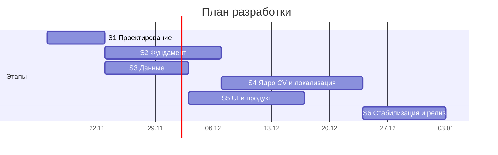
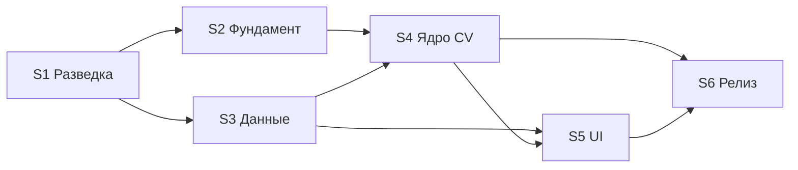

# Genshin Map Overlay — план реализации и определение MVP

**Версия:** 0.1 (draft)
**Дата:** 2026-11-10
**Связанные документы:** `ARCHITECTURE.md`

---

## 0. Принципы планирования

1. **Риск — вперёд.** Первыми делаем то, что может убить проект (композитинг оверлея, локализация),
   а не то, что приятно делать (красивый UI).
2. **Каждый этап заканчивается демо.** Не «код написан», а «вот экран, вот цифры».
3. **Вертикальные срезы.** После этапа 2 уже есть оверлей поверх игры (пусть с точкой-заглушкой),
   после этапа 4 — точка движется правильно, после этапа 5 — продукт.
4. **Критерий приёмки — измеримый.** «Работает» запрещено, «p99 ≤ 8 мс на 3 разрешениях» — можно.
5. **Go/No-Go после каждого этапа.** Если метрика не достигнута — не идём дальше, а меняем подход
   (см. §6, kill criteria).

Суммарная оценка: **10–11 недель** для одного разработчика (part-time ~20 ч/нед → ~18–20 недель).

---

## 1. Обзор этапов

| # | Этап | Недели | Главный результат | Go/No-Go |
|---|---|---|---|---|
| S1 | Проектирование и техническая разведка | 1 | Закрыты Q1–Q4, утверждены ADR, записан датасет | Ответ на «вращается ли миникарта» |
| S2 | Технический фундамент: захват + оверлей | 2 | Прозрачное окно 60 FPS поверх игры без эха | p99 ≤ 8 мс, 0% эха |
| S3 | Данные и база данных | 1.5 | SQLite + пакет карты + запросы < 1 мс | 100k маркеров, p99 < 1 мс |
| S4 | Основной функционал: CV + локализация | 2.5 | Позиция игрока по миникарте | медиана ≤ 3 м |
| S5 | Пользовательский интерфейс и продукт | 2 | Полный MVP-оверлей, калибровка, настройки | Сценарий приёмки пройден |
| S6 | Тестирование, стабилизация, релиз | 1.5 | Установщик, документация, презентация | 8 ч без утечек и крэшей |

S3 идёт параллельно S2: работа с данными не зависит от захвата экрана.

---

## 2. Этапы подробно

### S1. Проектирование и техническая разведка — 1 неделя

**Цель.** Убрать неопределённость, которая определяет всю математику проекта, и зафиксировать
архитектурные решения до написания кода.

**Что сделать:**

- [ ] Записать 5+ сессий по 3 минуты (`SessionRecorder`: WGC → PNG + timestamp + лог ввода).
      Условия: открытая местность, лес, город, пещера, ночь/день, бег/полёт/плыть.
- [ ] **Q1:** повернуть камеру на 90°/180° — определить, вращается ли миникарта. Зафиксировать в ADR.
- [ ] **Q2:** замерить `px_per_meter` и радиус миникарты по двум известным ориентирам.
- [ ] **Q3:** снять 3 разрешения × 3 HUD-scale, замерить геометрию круга, проверить зависимость.
- [ ] **Q4:** проверить, какие иконки вообще попадают на миникарту (влияет на необходимость YOLO).
- [ ] Утвердить ADR-001…007 из `ARCHITECTURE.md`.
- [ ] Создать каркас решения (проекты, слои, CI, `dotnet build` + тесты зелёные).
- [ ] Завести `docs/DECISIONS.md` с ответами Q1–Q4 и скриншотами-доказательствами.

**Результат:** документ с ответами Q1–Q4, датасет сессий, собирающийся каркас, утверждённые ADR.

**Как проверить завершение:**

1. В `DECISIONS.md` есть ответ на каждый из Q1–Q4 с доказательством (кадр/замер/скриншот).
2. `git clone && dotnet build && dotnet test` проходит на чистой машине.
3. Датасет содержит ≥ 5 сессий с ground truth (хотя бы приблизительным) и воспроизводится скриптом.
4. Любой разработчик по документу может объяснить, как считается позиция — без вопросов к автору.

**Риск этапа:** если миникарта вращается непредсказуемо (не по камере) — меняется ядро локализации.
Закрывается в первые 3 дня, поэтому этап короткий.

---

### S2. Технический фундамент: захват и оверлей — 2 недели

**Цель.** Доказать, что оверлей вообще возможен: 60 FPS, прозрачность, click-through, отсутствие эха
в захвате. Это самый частый «убийца» подобных проектов.

**Что сделать:**

- [ ] `Capture.Service`: WGC → D3D11 текстура → GPU-downscale 640×640 → `Map` в CPU.
      Обработка: свёрнутое окно, alt-tab, смена разрешения, `WM_DISPLAYCHANGE`, HDR.
- [ ] `Overlay.Presenter`: `WS_POPUP | WS_EX_NOREDIRECTIONBITMAP | WS_EX_TRANSPARENT |
      WS_EX_NOACTIVATE | WS_EX_TOOLWINDOW`, DirectComposition + swapchain с премультиплицированной
      альфой, Skia-рендер в текстуру.
- [ ] `SetWindowDisplayAffinity(WDA_EXCLUDEFROMCAPTURE)` + автотест «оверлей не в кадре».
- [ ] `Platform.Win32`: per-monitor v2 DPI, topmost-переустановка на смену foreground.
- [ ] `Ipc`: shared memory ring + MessagePack, версионирование схемы, watchdog CV-процесса.
- [ ] `Config`, `Telemetry`, `Input.Hotkeys` (toggle оверлея, пауза).
- [ ] Демо: поверх игры рисуется прямоугольник и FPS-счётчик; клики уходят в игру.

**Результат:** два процесса, которые общаются, оверлей стабильно рисует 60 FPS поверх borderless-игры.

**Как проверить завершение:**

| Проверка | Порог |
|---|---|
| FPS оверлея | 60 ± 1 на 1080p/1440p/4K |
| p99 frame time | ≤ 8 мс |
| Эхо в захвате | 0 кадров с пикселями оверлея (автотест по NCC эталонного паттерна) |
| Click-through | 20/20 кликов доходят до игры |
| alt-tab → возврат | < 500 мс до восстановления потока |
| Доп. загрузка GPU | ≤ 5% |
| RAM | ≤ 300 МБ за 1 час работы |
| DPI 100/125/150/200% | геометрия совпадает, нет размытия/сдвига |

**Риск этапа:** если DirectComposition-путь не даёт 60 FPS на слабых GPU — fallback на WPF
layered window (30–40 FPS) с пометкой в ограничениях. Это допустимая деградация MVP, но не цель.

---

### S3. Данные и база данных — 1.5 недели

**Цель.** Наполнить проект координатами и научиться отвечать «что рядом» за микросекунды.

**Что сделать:**

- [ ] Схема SQLite по `ARCHITECTURE.md` §5.3: миграции (v1 → vN), WAL, `marker_rtree`.
- [ ] `PackBuilder` — офлайн-утилита: JSON комьюнити-дампа → `markers.sqlite` + `manifest.json`
      + checksum. Импорт в рабочую БД транзакцией, идемпотентно.
- [ ] `Query.Engine`: «маркеры в радиусе», «k ближайших», фильтры по типу/слою/собранности.
- [ ] `Data.Tiles`: провайдер тайлов, LRU-кэш, предзагрузка соседних, декод WebP → текстура.
- [ ] `Session.State`: отметка «собрано», таймеры респавна (данные пишем сразу, UI потом).
- [ ] Нормализация координат: аффинное преобразование atlas px ↔ world meters, проверка на 5
      контрольных точках (≤ 2 м расхождения).
- [ ] Бенчмарки `BenchmarkDotNet` на запросы.

**Результат:** рабочая БД с полным набором маркеров и быстрый слой запросов.

**Как проверить завершение:**

1. Импорт полного пакета (≥ 100k маркеров) — < 30 с, повторный импорт не дублирует данные.
2. Запрос «в радиусе 200 м, 5 типов» — **p99 < 1 мс** на 10 000 запросов.
3. 100 координат из дампа вручную сверены с игрой — расхождение ≤ 2 м.
4. Миграция схемы на копии БД v1 → v2 сохраняет весь `marker_state`.
5. Битый/подменённый пакет отвергается по checksum, БД остаётся рабочей.

**Риск этапа:** лицензии и качество комьюнити-данных. Митигация: слой `payload` + поле `source`,
возможность смешивать источники и помечать непроверенные маркеры.

---

### S4. Основной функционал: CV и локализация — 2.5 недели

**Цель.** Главная техническая ценность: по картинке миникарты понять, где игрок, и не терять его.

**Что сделать:**

- [ ] `Vision.Minimap`: ROI из калибровки → `HoughCircles` → валидация → кроп → grayscale →
      CLAHE → маска HUD. Оценка поворота (Fourier–Mellin / маркер «N»).
- [ ] `Localization.Engine`, контур 1 — **одометрия**: phase correlation между кадрами,
      `peak_ratio`-гейтинг, перевод px → метры.
- [ ] `Localization.Engine`, контур 2 — **релокализация**: ORB + FLANN + RANSAC по атласу,
      приоритет локального поиска, NCC-пирамида как fallback.
- [ ] Контур 3 — **слияние**: Калман `[x, z, vx, vz]`, Mahalanobis-гейтинг, HMM слоёв,
      детект телепорта/загрузки, расчёт `confidence`.
- [ ] `Geo.Model`: единая цепочка преобразований Screen → Minimap → World → Atlas.
- [ ] Офлайн-харнесс `tests/Replay`: прогон записанных сессий, метрики точности, сравнение с baseline.
- [ ] Калибровочный алгоритм (автоопределение круга по 20 кадрам, медиана).

**Результат:** `GeoState` с координатами, который на записях сессий даёт приемлемую точность.

**Как проверить завершение:**

| Метрика (на 5 записанных сессиях, ≥ 30 мин суммарно) | Порог MVP |
|---|---|
| Медианная ошибка позиции | ≤ 3 м |
| p95 ошибки | ≤ 8 м |
| Доля времени в состоянии `Lost` | < 5% |
| Дрейф без релокализации | ≤ 1 м/мин |
| Частота обновления | ≥ 10 Гц |
| Время выхода из `Lost` после релокализации | < 1 с |
| Телепорт | позиция перескакивает, а не «доползает» |
| CPU на 1 ядро | ≤ 10% |

**Риск этапа:** если медиана > 10 м и нет понятного пути улучшения — включаем **план B**
(см. §6.2): снап позиции по телепорт-точкам + dead reckoning. Это меняет продукт, но сохраняет ценность.

---

### S5. Пользовательский интерфейс и продукт — 2 недели

**Цель.** Превратить работающее ядро в инструмент, которым можно пользоваться без инструкции.

**Что сделать:**

- [ ] **Оверлей-миникарта:** круг/панель в углу, тайлы карты под игроком, иконки маркеров
      в радиусе, стрелка игрока, север.
- [ ] **Подсказка «ближайший объект»:** стрелка-указатель на краю экрана, дистанция в метрах,
      подсказка «выше/ниже» по Y, фильтр по типу.
- [ ] **Честная индикация состояния:** `Tracking` / `Degraded` / `Lost` — визуально различимы,
      при `Lost` оверлей не показывает ложную позицию.
- [ ] **Калибровочный визард:** автоопределение круга → два ориентира → валидация 30 с →
      сохранение по профилю дисплея.
- [ ] **Настройки:** прозрачность, масштаб, позиция панели, фильтры типов, хоткеи, профили.
- [ ] **Трей-иконка**, автозапуск по желанию, выход.
- [ ] Локализация строк RU/EN.
- [ ] Пустые состояния, ошибки (игра не найдена, fullscreen, калибровка не пройдена).

**Результат:** полноценная MVP-версия, которую можно ставить и использовать.

**Как проверить завершение — сценарий приёмки (см. §3.4):**

1. Новый пользователь без подсказок автора проходит калибровку ≤ 2 минуты.
2. Все пункты MVP-скоупа (§3.2, колонка Must) работают на чистой машине.
3. Настройки и калибровка переживают перезапуск.
4. При сворачивании игры оверлей исчезает, при возврате — восстанавливается < 500 мс.
5. `Lost` наступает честно: закрыть миникарту рукой/UI — оверлей сообщает о потере, а не врёт.
6. UX-тест: 3 человека, 10 задач, ≥ 8/10 выполнены без объяснений.

**Риск этапа:** расползание скоупа. Жёсткое правило: любая фича не из MVP-списка — в бэклог v1.1.

---

### S6. Тестирование, стабилизация, релиз — 1.5 недели

**Цель.** Убедиться, что продукт не падает, не течёт и воспроизводимо собирается у другого человека.

**Что сделать:**

- [ ] Матрица тестов (см. §5): разрешения × HUD-scale × HDR × частота обновления × язык.
- [ ] Soak-тест 8 часов: RAM/GPU/хендлы — без роста; автотест на утечки.
- [ ] Регрессия на записанных сессиях в CI: точность локализации не падает ниже baseline.
- [ ] Fuzz/негативные тесты: битый пакет, отсутствующий файл, нехватка прав, смена монитора.
- [ ] Фиксы по багам, приоритизация (blocker / major / minor), баг-лист с закрытием.
- [ ] Упаковка: self-contained publish, установщик, portable-версия, `.gitignore` для `packs/`.
- [ ] Документация: README, требования (borderless), FAQ, дисклеймер про ToS.
- [ ] Презентация: 8–10 слайдов + 2-минутное демо-видео + живое демо.

**Результат:** релизный артефакт, который ставится на чистую машину и работает по сценарию.

**Как проверить завершение:**

| Проверка | Порог |
|---|---|
| Soak 8 ч | RAM +0 МБ, GPU стабильно, 0 крэшей |
| 20 последовательных запусков | 20/20 успешных |
| Чистая Windows 11 VM | установка → калибровка → работа < 5 мин |
| Матрица тестов | 100% Must-кейсов пройдено |
| Крэш-репорты | 0 известных blocker/major |
| Демо-сценарий | проходится за ≤ 2 мин без запинки |

---

## 3. MVP

### 3.1 Исходная проблема → минимальное решение

> «Игрок не знает, где рядом сундук или ресурс, и не хочет переключаться в браузер с интерактивной картой.»

Минимальное решение, которое это закрывает: **оверлей, который сам знает, где игрок, и показывает
ближайшие объекты прямо на экране.** Без ручного ввода координат, без переключения окон, без
браузера на втором мониторе.

Отсюда три обязательных столпа MVP:
1. **Автоопределение позиции** (иначе это просто ещё одна карта в браузере).
2. **База маркеров** (иначе нечего показывать).
3. **Отрисовка поверх игры** (иначе это не решает проблему переключения).

Если убрать любой из трёх — проблема не решена.

### 3.2 Состав MVP (MoSCoW)

| Приоритет | Функция | Обоснование |
|---|---|---|
| **Must** | Захват borderless-окна игры | без него нет позиции |
| **Must** | Локализация по миникарте (одометрия + релокализация + KF) | ядро продукта |
| **Must** | Калибровка под разрешение/HUD-scale | без неё не работает ни у кого, кроме автора |
| **Must** | SQLite с сундуками и 5–8 основными типами ресурсов | контент |
| **Must** | Оверлей-миникарта: карта + иконки в радиусе | «миникарта со всеми ресурсами вокруг» |
| **Must** | Указатель на ближайший объект + дистанция | «показ ближайшего сундука» |
| **Must** | Click-through, topmost, скрытие из захвата | иначе играть невозможно |
| **Must** | Хоткей показать/скрыть + пауза | базовое управление |
| **Must** | Честная индикация `Tracking/Degraded/Lost` | продукт не должен врать |
| **Must** | Трей + сохранение настроек | нормальная эксплуатация |
| **Should** | Фильтры по типу объекта | иначе экран зашумлён |
| **Should** | Отметка «собрано» + затемнение иконки | очень ожидаемо игроками |
| **Should** | Прозрачность/масштаб панели | комфорт |
| **Should** | Таймеры респавна ресурсов | сильная ценность, дёшево при готовой БД |
| **Could** | Поиск объекта по названию | удобство |
| **Could** | Мини-компас с азимутом | альтернативный вид |
| **Could** | Экспорт/импорт прогресса | переносимость |
| **Won't (v1)** | YOLO-детекция объектов на экране | база координат точнее и дешевле |
| **Won't (v1)** | Подземелья и многослойные регионы | резко растит сложность |
| **Won't (v1)** | Автопрокладка маршрута | не решает исходную проблему |
| **Won't (v1)** | OCR, автообновление, облако, аккаунты | вне MVP |
| **Won't (v1)** | Любая автоматизация ввода | ToS и риск бана |

### 3.3 Явные границы MVP

- Только **поверхностный слой** одного-двух регионов (Мондштадт, Ли Юэ) — не весь Тейват.
- Только **borderless windowed**, одно разрешение из калиброванных профилей (лучше — авто).
- Только **Windows**, x64.
- Только **RU** (EN как задел, но не блокер).
- Ресурсы: сундуки + 5–8 категорий (руда, цветы, грибы, рыба, кристаллы, дичь).

### 3.4 Сценарий приёмки MVP (ручной тест, 10 шагов)

1. Запустить Genshin в borderless, запустить оверлей.
2. Пройти калибровку (≤ 2 мин): круг определился, два ориентира, валидация.
3. Нажать хоткей — появилась миникарта с иконками.
4. Пройти 50 м — стрелка и иконки движутся синхронно с игрой, без рывков.
5. Подойти к сундуку из базы — указатель показывает направление, дистанция уменьшается.
6. Открыть сундук — иконка помечается собранной (после подтверждения или вручную).
7. Телепортироваться — позиция перескакивает корректно за < 1 с.
8. Свернуть игру на 30 с, вернуться — оверлей восстановился, позиция верна.
9. Закрыть миникарту в игре (UI-режим) — оверлей честно ушёл в `Lost`.
10. Перезапустить — калибровка и настройки на месте.

**MVP принят, если:** 10/10 шагов проходят у автора и 8/10 у стороннего тестировщика
без подсказок, а метрики §S4 и §S2 в допуске.

### 3.5 Метрики MVP (сводно)

| Метрика | Порог |
|---|---|
| Точность позиции (медиана) | ≤ 3 м |
| Точность (p95) | ≤ 8 м |
| Время в `Lost` | < 5% |
| FPS оверлея | 60, p99 ≤ 8 мс |
| Задержка «мир → пиксель» | ≤ 150 мс |
| Доп. GPU | ≤ 5% |
| RAM | ≤ 300 МБ |
| Калибровка новым пользователем | ≤ 2 мин |
| Установка и первый запуск | ≤ 5 мин |

---

## 4. Зависимости и параллелизм

- **S3 можно начинать сразу после S1** — не зависит от захвата.
- **S5 требует S3 и S4** — UI рисует реальные данные, а не заглушки.
- **S4 — критический путь.** Любая задержка здесь сдвигает весь проект.
- Если разработчик один: S2 и S3 частично последовательны, срок растягивается на ~2 недели.

---

## 5. Definition of Done и матрица тестов

### 5.1 DoD этапа (общий)

- [ ] Код в репозитории, ревью/самопроверка, сборка без предупреждений.
- [ ] Unit-тесты на новую логику; бенчмарки для горячих путей.
- [ ] Обновлён `ARCHITECTURE.md` / `DECISIONS.md`, если решение изменилось.
- [ ] Метрики этапа измерены и записаны в `docs/METRICS.md` с датой и конфигурацией.
- [ ] Демо-запись этапа (30–60 с) приложена.

### 5.2 Матрица тестов (S6)

| Ось | Значения |
|---|---|
| Разрешение | 1920×1080, 2560×1440, 3840×2160 |
| Масштаб Windows | 100%, 125%, 150%, 200% |
| HUD-scale в игре | 1.0, 1.2, 1.5 |
| HDR | вкл / выкл |
| Частота | 60, 120, 144 Гц |
| Состояние | открытая местность, лес, город, пещера, вода, катсцена, загрузка |
| Язык | RU, EN |
| Окно | borderless, свёрнуто, alt-tab, второй монитор |

Полный перебор — 3 × 4 × 3 = 36 комбинаций геометрии (smoke) + 8 сценариев поведения (full).

---

## 6. Управление рисками

### 6.1 Kill criteria (когда меняем подход, а не «дожимаем»)

| Точка | Условие провала | Действие |
|---|---|---|
| Конец S2 | p99 frame > 16 мс или эхо не устранимо | Fallback на WPF layered (30 FPS) + сузить функционал; либо C++/D2D |
| Конец S3 | данные непригодны (координаты не сходятся > 10 м) | Ручная калибровка координат по контрольным точкам, сократить регион |
| Середина S4 | медиана ошибки > 10 м на 2+ сессиях | План B (§6.2) |
| Конец S5 | калибровка занимает > 5 мин или ломается на 30% конфигураций | Автокалибровка по 3+ профилям, упрощение |
| Конец S6 | soak-тест течёт | Релиз с ограничением «сессия ≤ 2 ч», фикс в v1.0.1 |

### 6.2 План B для локализации (если CV не даёт точности)

**Снап по телепорт-точкам + dead reckoning:**
- Детект открытия карты/телепорта (полноэкранный UI — надёжно ловится).
- Позиция телепорт-точки известна из БД → точный снап.
- Между снапами — та же одометрия по миникарте, но без глобальной релокализации.
- Точность: ±1 м сразу после телепорта, дрейф ≤ 1 м/мин.

Это честно решает исходную проблему (игрок телепортируется к точке и идёт к ближайшему сундуку),
хотя и требует от игрока одного действия. Хороший fallback и заодно режим для подземелий.

### 6.3 Правовой риск

Дисклеймер в README и в установщике: инструмент read-only, не модифицирует игру, не автоматизирует
ввод, использует только захват экрана; использование — на усмотрение пользователя и на его риск.
Не добавлять обфускацию, скрытность, автозапуск «втихую» — это повышает риск и убивает доверие.

---

## 7. После MVP (бэклог v1.1+)

| Приоритет | Фича | Зачем |
|---|---|---|
| 1 | YOLO-детекция сундуков и интерактивных объектов | ловит то, чего нет в базе |
| 2 | Подземелья и слои (Разлом, Энканомия) | покрытие контента |
| 3 | Маршруты «собери всё в радиусе» | сильная утилита фарма |
| 4 | Компаньон-окно на втором мониторе | большой экран, детальная карта |
| 5 | OCR подсказок взаимодействия | автоматизация отметки «собрано» |
| 6 | Автообновление пакетов | актуальность после патчей |
| 7 | Полный Тейват, все типы ресурсов | полнота |

---

## 8. Резюме для защиты

- **6 этапов, ~10–11 недель**, критический путь: S2 → S4 → S5 → S6.
- **MVP = авто-позиция + база маркеров + оверлей-миникарта + указатель на ближайший объект.**
  Всё остальное — бэклог.
- **Главный риск** — локализация; проверяется на S4 с измеримым порогом (медиана ≤ 3 м) и имеет план B.
- **Главный «убийца» проектов** — композитинг оверлея (эхо в захвате, FPS, DPI); вынесен в S2,
  чтобы провалиться быстро и дёшево, а не на финише.
- Каждый этап заканчивается **измеримой приёмкой**, а не субъективным «выглядит нормально».
